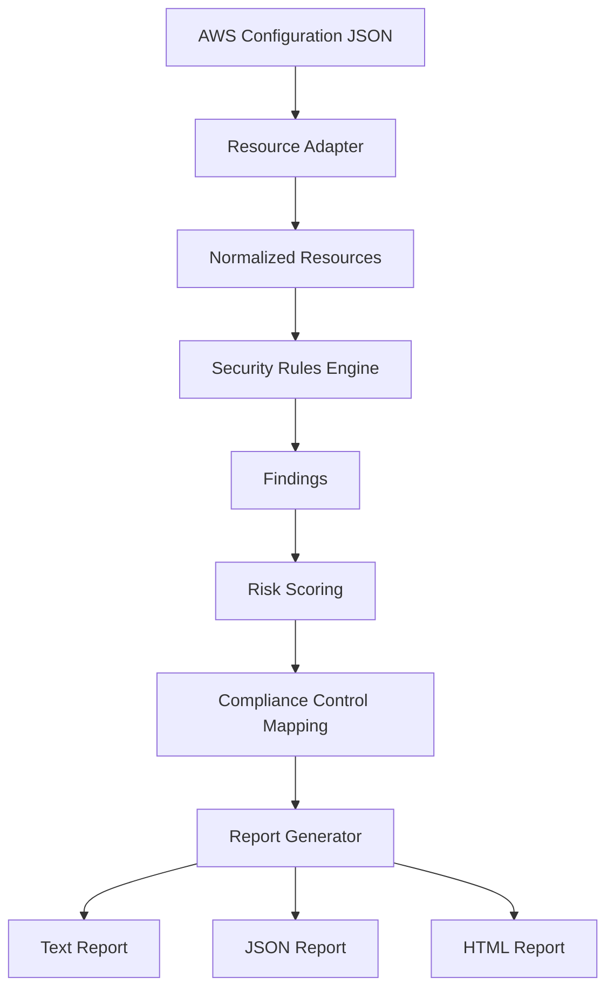

# Cloud Posture Analyzer

A Python-based AWS cloud security posture analyzer that identifies common cloud misconfigurations, evaluates risk, and generates security reports with relevant ISO 27001 and SOC 2 control mappings.

## Overview

Cloud Posture Analyzer is a lightweight security assessment tool designed to analyze AWS resource configuration data and identify potentially risky settings.

The analyzer evaluates resources against a set of security rules, calculates risk scores, and produces reports in text, JSON, and HTML formats.

It is designed as a portfolio project demonstrating security automation, Python development, risk assessment, testing, and CI/CD practices.

## Features

- Rule-based AWS configuration analysis
- Detection of common IAM, S3, network, and logging misconfigurations
- Risk scoring based on severity, exposure, and resource criticality
- Risk labels: Critical, High, Medium, and Low
- Relevant ISO 27001 and SOC 2 control mappings
- Text, JSON, and HTML reports
- HTML output with automatic escaping
- CLI threshold option (`--fail-on`) for automation
- Automated tests with pytest
- GitHub Actions CI pipeline

## Architecture



## Requirements

- Python 3.12 or newer
- pip

## Installation

Clone the repository:

```bash
git clone https://github.com/DaNa-cpu/cloud-posture-analyzer.git
cd cloud-posture-analyzer
```

Create and activate a virtual environment:

```bash
python3 -m venv .venv
source .venv/bin/activate
```

Install dependencies:

```bash
pip install -r requirements.txt
```

## Usage

Run the demo:

```bash
python scan.py --demo
```

Analyze a sample environment:

```bash
python scan.py -i fixtures/sample_env.json
```

Analyze a clean environment:

```bash
python scan.py -i fixtures/clean_env.json
```

Generate a JSON report:

```bash
python scan.py -i fixtures/sample_env.json --format json
```

Generate an HTML report:

```bash
python scan.py -i fixtures/sample_env.json \
  --format html \
  --output reports/report.html
```

Use the exit code to enforce a risk threshold in automation:

```bash
python scan.py -i fixtures/sample_env.json --fail-on high
```

The CLI returns a non-zero exit code when the configured risk threshold is reached.

## Security Rules

The analyzer currently includes the following rule categories:

| Rule ID | Category | Security check |
|---|---|---|
| S3-001 | S3 | [Insert exact rule title/check] |
| S3-002 | S3 | S3 bucket encryption disabled |
| S3-003 | S3 | S3 bucket versioning disabled |
| IAM-001 | IAM | Excessive administrative permissions |
| IAM-002 | IAM | Root account MFA disabled |
| NET-001 | Network | SSH exposed to the internet |
| NET-002 | Network | RDP exposed to the internet |
| LOG-001 | Logging | CloudTrail logging disabled |

## Risk Scoring

Each finding receives a risk score based on three factors:

- Severity: How serious the security issue is.
- Exposure: How accessible or exposed the affected resource is.
- Criticality: How important the affected resource is.

The scoring formula is:

```text
Risk Score = Severity × Exposure × Criticality
```

Each factor is an integer from 1 to 5.

The maximum possible score is 125.

Risk labels:

| Risk score | Label |
|---:|---|
| 80–125 | Critical |
| 45–79 | High |
| 15–44 | Medium |
| 1–14 | Low |

This is a project-specific prioritization model, **not CVSS**. It is not an official vulnerability severity standard and should not be interpreted as a CVSS score.

## Compliance Mapping

Findings include relevant control mappings for:

- ISO/IEC 27001
- SOC 2

These mappings provide context about which security controls may be relevant to a detected configuration issue.

They are **relevant control mappings**, not proof of compliance or non-compliance. The analyzer does not perform a complete ISO 27001 or SOC 2 audit.

## Limitations

- The current input is configuration data supplied as JSON fixtures.
- The project does not currently collect live AWS configuration through boto3.
- The analyzer evaluates only the security rules implemented in the project.
- It does not perform penetration testing or exploit validation.
- It does not scan application source code, container images, or running workloads.
- Its risk score is a prioritization mechanism, not a formal compliance or vulnerability rating.
- Compliance mappings do not replace an independent audit.

## Future Improvements

- Add a live AWS collector using boto3.
- Expand coverage with additional AWS security rules.
- Integrate Trivy for container and image scanning.
- Add more compliance framework mappings.
- Support additional report formats and richer reporting.
- Add integration tests using representative AWS configuration data.

## Testing

Run the test suite:

```bash
pytest
```

The project uses GitHub Actions to automatically run tests, validate the clean fixture, and generate an HTML report.

## Project Structure

```text
cloud-posture-analyzer/
├── .github/
│   └── workflows/
│       └── ci.yml
├── cloud_analyzer/
│   ├── adapter.py
│   ├── compliance.py
│   ├── engine.py
│   ├── models.py
│   ├── reports.py
│   ├── rules.py
│   └── templates/
│       └── report.html.j2
├── fixtures/
│   ├── clean_env.json
│   └── sample_env.json
├── mappings/
│   └── controls.yaml
├── tests/
├── risk.py
├── scan.py
├── requirements.txt
└── README.md
```